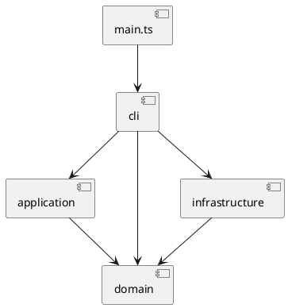
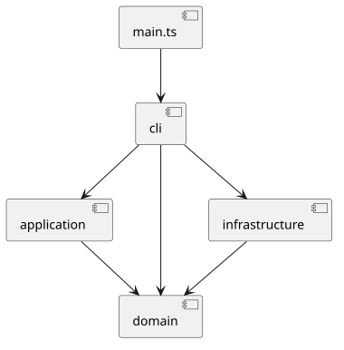
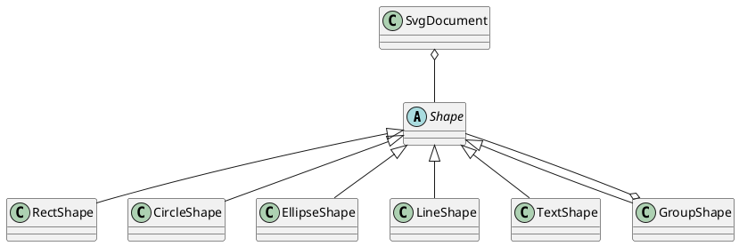

# SVG 编辑器（CLI）

本文档随实现迭代维护。实验原文位于 [`phase_cli_1.md`](../phase_cli_1.md)。仓库地址 https://github.com/galaxyzhe/svg_cli.git。

## 架构方案

### 模块划分

当前实际采用以下模块边界：

- `src/cli`：REPL、命令解析、命令注册/分发、输出格式化。
- `src/application`：Command 接口、Invoker、UndoManager、命令实现和应用上下文。
- `src/domain`：`SvgDocument`、统一 `Shape` 抽象、叶子图形、`g` 容器、`ShapeFactory` 和受控树操作令牌。
- `src/infrastructure`：SVG 读写和文件系统适配。
- `tests`：领域单元测试、应用层测试、infrastructure 测试、CLI 集成测试和阶段验收测试。

### 组件关系

图中的 `cli -> domain` 是当前真实依赖：`CommandRegistry` 需要直接创建 `GroupShape`、调用 `ShapeFactory` 并读取 `SvgDocument`；这不是理想化的间接依赖，已在依赖规则中明确记录。

领域类关系如下：

领域层关键不变量：

- `SvgDocument` 的 id 索引与根级树递归节点保持一一对应，id 全局唯一且大小写敏感。
- 一个 `Shape` 至多拥有一个父级；容器不能收纳自身或自己的后代。
- `GroupShape` 的子项使用有序数组保存，移动父级时先完成合法性校验，再更新父子关系。
- 图形挂载到 `SvgDocument` 后，GroupShape 结构变更必须通过文档操作；`ShapeTreeToken` 只供文档内部受控更新父子关系。
- 画布尺寸和 viewBox 通过 getter 暴露，修改必须经过 `SvgDocument` 的校验方法。
- `move` 和 `scale` 由 `Shape` 多态实现；容器只递归调用每个直接子项一次，避免重复变换。
- 几何属性只能由具体图形类处理，公共属性仅限 `fill`、`stroke`、`stroke-width`；文本内容使用独立的 `text` 属性。

### 设计模式

#### Command

`src/application/Command.ts` 定义 `execute()` / `undo()` 接口，`AbstractCommand` 管理命令状态。
`CreateCommand`、`DeleteCommand`、`MoveCommand`、`ScaleCommand`、`SetCommand`、`GroupCommand`、`UngroupCommand`、`AddToCommand`、`FrontCommand` 和 `BackCommand` 分别封装一条编辑操作。
`CommandInvoker` 统一执行编辑命令和显示命令；编辑命令成功后交给 `UndoManager` 入栈，显示命令不入栈。`UndoManager` 维护 undo/redo 栈，并在 init/read/save/canvas 修改后锁定历史。
CLI 解析器不修改领域对象，`CommandRegistry` 负责构造 Command 并调用 Invoker。

#### Composite

`Shape` 是统一抽象；`RectShape`、`CircleShape`、`EllipseShape`、`LineShape`、`TextShape` 是叶子，`GroupShape` 是 Composite 容器并保存有序子项。
叶子和 `g` 都通过 `move`、`scale`、`setAttribute`、`toSvg` 参与统一操作；GroupShape 对子树递归调用 move/scale，SvgDocument 负责父级、全局 id 索引和结构合法性。

#### Factory

`ShapeFactory` 是唯一的图形类型名分派点，集中创建本阶段六种内置类型：`rect`、`circle`、`ellipse`、`line`、`text`、`g`。
未知类型（包括 `box`）抛出 `unknown shape type`；本阶段没有插件加载、ShapeProvider 或 box 实现。

#### 适配职责

`SvgReader` 使用 `fast-xml-parser` 将 XML 节点适配为领域对象，`SvgWriter` 将领域对象适配为 SVG XML，`SvgIoError` 统一文件系统错误。这是基础设施适配职责，不把 XML 或文件系统依赖带入 domain。

命令名到命令实现的集中分派仅允许位于命令注册/分发处；图形类型到图形类的集中分派仅允许位于 `ShapeFactory`。
当前对应实现分别是 `CommandRegistry.handlers` 和 `ShapeFactory` 中的类型分派；它们是本阶段明确保留的可演进点。`box` 插件属于后续阶段，当前不预留插件加载实现。

### 依赖方向规则

- `domain` 不依赖 `cli`、`application` 或具体文件系统实现。
- `application` 依赖 `domain`，不依赖 CLI 输出细节。
- `infrastructure` 依赖领域接口或模型，负责外部 SVG 和文件系统适配。
- `cli` 可以依赖 `application`、`domain` 和基础设施适配；当前 `CommandRegistry` 直接使用 domain 的查询/工厂/容器类型，但编辑仍通过 application Command 执行。
- `main.ts` 只依赖 CLI 的 `Repl` 入口。
- `tests` 可以依赖被测模块，不反向成为生产代码依赖。

禁止 `domain` 依赖 `cli`、`application`、`infrastructure` 或 XML/文件系统库；禁止 `application` 依赖 CLI 输出和文件系统；禁止 infrastructure 反向依赖 CLI 或 application；禁止测试代码被生产模块依赖。

### 变化点假设

- 命令集合可能扩展，因此保留 `CommandRegistry` 分派边界；当前不把命令名分派分散到 Parser 或领域类。
- 图形类型可能扩展，因此保留 `ShapeFactory` 边界；`box` 及插件注册机制明确留到后续阶段。
- XML 库或 SVG 文件格式适配可能替换，因此隔离 `SvgReader`/`SvgWriter`；当前没有抽象 XML 库接口，因为只有一个实现且实验范围固定。
- 撤销/重做策略可能扩展，因此隔离 `UndoManager`；当前命令快照策略满足本阶段，不提前引入持久化历史。
- CLI 输出格式可能变化，因此集中在 `OutputFormatter`；当前不为每个摘要建立独立渲染插件。

## 过程记录

阶段二先依据实验原文确认了六种内置图形、左上角坐标系、全局 id、Composite 递归操作和 `set` 白名单。
实现中先完成 `Shape` 抽象、五种叶子图形、`GroupShape` 和 `SvgDocument`，再用单元测试验证几何变换与树结构。
测试首次发现未知属性会先被当作数字解析，修正为先进行属性白名单判断，再解析几何值；随后补充了多态 SVG 序列化和 XML 转义测试。
对应提交为 `432336f feat: implement SVG domain composite model`。

阶段三实现了应用层 Command、CommandInvoker 和 UndoManager。命令构造函数接收领域对象与明确参数，不解析 CLI 字符串；显示命令通过 `executeDisplay` 执行，不进入历史。
各命令的撤销策略如下：

- `CreateCommand`：保存插入位置；撤销删除创建的子树，重做按原位置插入。
- `DeleteCommand`：保存被删子树、原父级和原索引；撤销按原位置恢复完整子树。
- `MoveCommand`：撤销使用相反的平移增量。
- `ScaleCommand`：撤销使用倒数缩放因子。
- `SetCommand`：保存旧属性值；公共属性原先不存在时，撤销删除该属性；文本通过 `text` 属性恢复。
- `GroupCommand`：保存每个目标的原父级/原索引和新组位置；撤销按原索引逆序恢复后删除新组。
- `UngroupCommand`：保存原容器位置和子项顺序；撤销恢复容器，再按原顺序移回子项。
- `AddToCommand`：保存原父级/原索引，撤销移回原位置。
- `FrontCommand` / `BackCommand`：保存原索引，撤销恢复原 z-order。

历史栈在文档类操作后清空并锁定；下一条成功的编辑命令清空 redo 并解除锁定。命令执行失败不会被记录。
对应提交为 `34e503f feat: add command undo redo framework`。

阶段四选择 `fast-xml-parser` 作为 XML 库。它支持 XML 实体、属性、文本节点和保序嵌套解析，避免手工字符串切割；Reader 只负责 XML 到领域对象的适配，Writer 只负责文档封装，图形序列化仍由 `Shape.toSvg()` 多态完成。
不支持的 SVG 标签采用由 `ShapeFactory` 明确拒绝并抛出 unknown shape type 的策略；未知图形类型（包括 `box`）不降级。
对应提交为 `d9558a2 feat: add SVG factory reader and writer`。

阶段五实现了 `src/cli` 的词法解析、命令注册、会话和 REPL。`CommandLineParser` 支持双引号、空格、反斜杠转义、空行和注释；`CommandRegistry` 是唯一的命令名到处理器分派点，编辑处理器只构造 Command 并交给 `CommandInvoker`。
典型会话回放确认了启动提示、`svg>` 提示符、create in、group、move/undo/redo、set、tree、save、IO 后 undo 限制和 quit；输出摘要与实验示例的差异仅为措辞，例如 move 使用 `moved by`，不改变命令语义。
对应提交为 `3946772 feat: implement SVG editor CLI`；随后 `b3e5920 fix: include container id in group cycle errors` 对齐了错误表中的容器 id。

**阶段六验收矩阵**

| 类别 | 验收内容 | 代码/测试证据 | 状态 |
|---|---|---|---|
| A | init/read/save/canvas、路径、warning、历史限制 | `CommandRegistry`、`SvgReader`、`SvgWriter`、`acceptance.test.ts` | 通过 |
| B | 六种 create、可选样式、id、create in、set、text | `ShapeFactory`、具体 Shape、`acceptance.test.ts`、`cli.test.ts` | 通过 |
| C | group/addto/ungroup、z-order、delete、Composite、环校验 | Command 类、`GroupShape`、`application.test.ts` | 通过 |
| D | undo 单元、redo 清空、显示命令、失败命令、文档锁定 | `CommandInvoker`、`UndoManager`、`application.test.ts` | 通过 |
| E | 错误表中的 id、容器、类型、scale、文件和无文档错误 | `CommandRegistry`、`CliSession`、`acceptance.test.ts` | 通过 |
| F | XML、命名空间、尺寸、viewBox、转义、顺序、round-trip | `SvgReader`、`SvgWriter`、`infrastructure.test.ts` | 通过 |

复合图形 ungroup 场景按阶段边界不可达：本阶段没有 `box`，叶子执行 ungroup 会报告 `not a container`。已知限制是典型 transcript 的 move/undo/redo 使用通用摘要，不生成每种图形的详细坐标回显；不支持的 SVG 标签由 `ShapeFactory` 明确拒绝，不做降级。

## 一致性自查

实际实现目录与方案一致：领域代码位于 `src/domain`，应用层代码位于 `src/application`，基础设施代码位于 `src/infrastructure`，CLI 位于 `src/cli`，测试位于 `tests`。
实际实现目录现包含 `src/infrastructure` 的 SVG Reader/Writer 和文件错误适配，以及 `src/cli` 的 Parser、Registry、Context、Formatter、Session 和 Repl；domain 还包含 `ShapeTreeToken` 用于保护已挂载树。Reader 依赖 XML 库，领域模型不依赖 XML 库或具体文件系统。应用层只依赖领域模型，不依赖 CLI 或文件系统。
`ShapeFactory` 和 `CommandRegistry` 分别承担实验允许的两个按名字分派点；没有实现 `box`。
检查方法：阅读各模块 import、对照组件图并执行 TypeScript 编译；当前未发现违反上述依赖方向的 import。CLI 直接依赖 domain 是已知且记录在方案中的现状，不列为违规项。

## 质量保证手段

计划使用以下手段：

- TypeScript 严格类型检查和生产构建。
- 针对领域对象、命令执行/撤销、读写适配器的单元测试。
- 针对 CLI 输入输出、错误状态不变和 undo/redo 的集成测试。
- 典型会话及异常场景的 CLI 验收。

本阶段实际完成：领域单元测试覆盖六类图形、move/scale、嵌套容器、唯一 id、父子环、顺序、属性白名单、浮点值、SVG 序列化、已挂载树保护和 viewBox 封装；通过 TypeScript 严格类型检查和生产构建验证。
阶段三追加应用层测试，覆盖十条命令、undo/redo、结构恢复、历史锁定、显示命令跳过历史和失败命令状态不变。
阶段四追加 infrastructure 测试，覆盖实验样例、自动 id、重复 id、嵌套顺序、中文与 XML 转义、round-trip、未知类型、不支持标签和文件错误。
阶段五追加 CLI 会话测试和真实管道回放，覆盖引号文本、注释、空行、完整编辑流程、错误前缀、失败状态不变、tree/show/help、退出命令和文档类操作。

阶段六最终测试为 5 个测试文件、35 个测试通过；阶段八修复后为 5 个测试文件、40 个测试通过。实际执行了 `npm.cmd test`、`npm.cmd run build`、`npm.cmd run typecheck` 和 `git diff --check`，均通过；另执行了 `npm.cmd run cli` 管道脚本回放，验证 Windows 临时路径、save/read、warning、tree 和 IO 后 undo。

阶段六先以验收矩阵和基线测试开始，新增 6 项验收测试。发现并修复了五类边界问题：`create in` 原先把缺失容器报告为 no such shape，修正为 no such container；`readFile` 原先把重复 id 等解析错误包装成 cannot read file，改为保留具体领域错误；Tokenizer 原先丢弃 Windows 路径中未知反斜杠，改为只解析定义的转义；文本内容为 `in` 原先被误判为尾缀子句，改为只识别倒数第二个 token 的 `in`；无文档 undo/redo 原先报告 nothing to undo，改为统一 no-document 错误。对应提交为 `b9f9838 test: complete SVG CLI acceptance`。

阶段八根据最终架构审查先增加回归测试，再修复了审查发现的问题：已挂载 GroupShape 的直接结构修改现在被拒绝，避免绕过 SvgDocument id 索引；SvgDocument 的画布/viewBox 状态改为封装；Parser 不再把 Windows 路径中的普通反斜杠片段当作控制转义；help 补充完整 create 语法；text 内嵌不支持元素不再静默丢弃；测试脚本不再使用 `--passWithNoTests`。同时补充了 scale/ungroup redo、失败 read 保持原文档等测试。