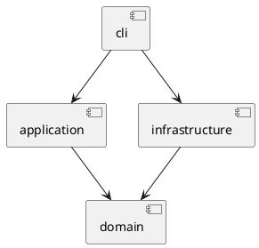
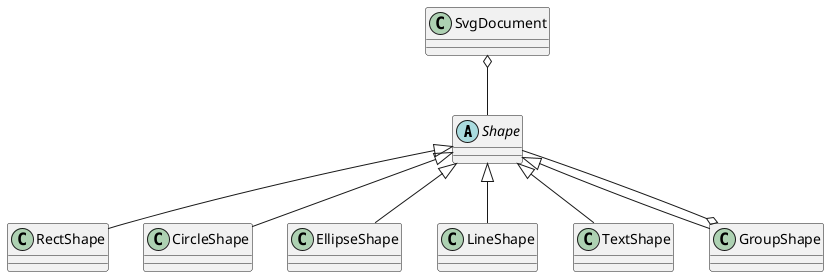

# SVG 编辑器（CLI）

本文档随实现迭代维护。实验原文位于 [`phase_cli_1.md`](../phase_cli_1.md)。

## 架构方案

### 模块划分

计划采用以下最小模块边界：

- `src/cli`：REPL、命令解析、命令注册/分发、输出格式化。
- `src/application`：Command 接口、Invoker、UndoManager、命令实现和应用上下文。
- `src/domain`：`SvgDocument`、统一 `Shape` 抽象、叶子图形、`g` 容器和 `ShapeFactory`。
- `src/infrastructure`：SVG 读写和文件系统适配。
- `tests`：领域单元测试、应用层测试和 CLI 集成测试。

当前阶段已实现 `src/domain` 的领域模型和单元测试；CLI、Command、SVG 文件读写适配器及插件仍未实现。

### 组件关系

领域类关系如下：

领域层关键不变量：

- `SvgDocument` 的 id 索引与根级树递归节点保持一一对应，id 全局唯一且大小写敏感。
- 一个 `Shape` 至多拥有一个父级；容器不能收纳自身或自己的后代。
- `GroupShape` 的子项使用有序数组保存，移动父级时先完成合法性校验，再更新父子关系。
- `move` 和 `scale` 由 `Shape` 多态实现；容器只递归调用每个直接子项一次，避免重复变换。
- 几何属性只能由具体图形类处理，公共属性仅限 `fill`、`stroke`、`stroke-width`；文本内容使用独立的 `text` 属性。

### 设计模式

必须使用 Command 模式：每条编辑命令由独立命令对象封装，并提供 `execute` / `undo`。
图形统一使用 `Shape` 抽象，叶子与 `g` 容器遵循 Composite 语义。

命令名到命令实现的集中分派仅允许位于命令注册/分发处；图形类型到图形类的集中分派仅允许位于 `ShapeFactory`。
这两处是本阶段明确保留的可演进点，未来可替换为注册表或插件机制。

### 依赖方向规则

- `domain` 不依赖 `cli`、`application` 或具体文件系统实现。
- `application` 依赖 `domain`，不依赖 CLI 输出细节。
- `infrastructure` 依赖领域接口或模型，负责外部 SVG 和文件系统适配。
- `cli` 可以依赖 `application` 与基础设施适配，但不直接操作图形内部状态。
- `tests` 可以依赖被测模块，不反向成为生产代码依赖。

### 变化点假设

- 命令集合可能扩展，因此保留命令注册/分发边界。
- 图形类型可能扩展，因此保留 `ShapeFactory` 边界；`box` 不在本阶段实现。
- SVG 输入输出实现可能替换，因此隔离基础设施适配。
- 撤销/重做策略可能扩展，因此隔离 `UndoManager`。

## 过程记录

阶段二先依据实验原文确认了六种内置图形、左上角坐标系、全局 id、Composite 递归操作和 `set` 白名单。
实现中先完成 `Shape` 抽象、五种叶子图形、`GroupShape` 和 `SvgDocument`，再用单元测试验证几何变换与树结构。
测试首次发现未知属性会先被当作数字解析，修正为先进行属性白名单判断，再解析几何值；随后补充了多态 SVG 序列化和 XML 转义测试。

## 一致性自查

实际实现目录与方案一致：领域代码位于 `src/domain`，测试位于 `tests`；本阶段未提前实现 CLI、应用层命令或基础设施读写。
领域类只依赖领域内部类型和错误类型，没有依赖 CLI、应用层或文件系统。当前 `GroupShape` 可独立构造，文档通过 `SvgDocument` 入口维护全局索引和归属。
命令分发和 `ShapeFactory` 尚未实现，因此本阶段没有新增按名字分派点，也没有实现 `box`。

## 质量保证手段

计划使用以下手段：

- TypeScript 严格类型检查和生产构建。
- 针对领域对象、命令执行/撤销、读写适配器的单元测试。
- 针对 CLI 输入输出、错误状态不变和 undo/redo 的集成测试。
- 典型会话及异常场景的 CLI 验收。

本阶段实际完成：领域单元测试覆盖六类图形、move/scale、嵌套容器、唯一 id、父子环、顺序、属性白名单、浮点值和 SVG 序列化；通过 TypeScript 严格类型检查和生产构建验证。