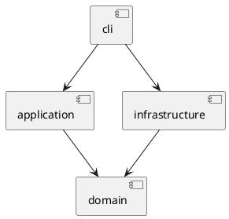

# SVG 编辑器（CLI）

本文档随实现迭代维护。实验原文位于 [`phase_cli_1.md`](../phase_cli_1.md)。

## 架构方案

### 模块划分

计划采用以下最小模块边界：

- `src/cli`：REPL、命令解析、命令注册/分发、输出格式化。
- `src/application`：Command 接口、Invoker、UndoManager、命令实现和应用上下文。
- `src/domain`：`SvgDocument`、统一 `Shape` 抽象、叶子图形、`g` 容器和 `ShapeFactory`。
- `src/infrastructure`：SVG 读写和文件系统适配。
- `tests`：领域单元测试、应用层测试和 CLI 集成测试。

当前阶段只建立目录与入口骨架，尚未实现上述领域或命令功能。

### 组件关系

### 设计模式

必须使用 Command 模式：每条编辑命令由独立命令对象封装，并提供 `execute` / `undo`。
图形统一使用 `Shape` 抽象，叶子与 `g` 容器遵循 Composite 语义。

命令名到命令实现的集中分派仅允许位于命令注册/分发处；图形类型到图形类的集中分派仅允许位于 `ShapeFactory`。
这两处是本阶段明确保留的可演进点，未来可替换为注册表或插件机制。

### 依赖方向规则

- `domain` 不依赖 `cli`、`application` 或具体文件系统实现。
- `application` 依赖 `domain`，不依赖 CLI 输出细节。
- `infrastructure` 依赖领域接口或模型，负责外部 SVG 和文件系统适配。
- `cli` 可以依赖 `application` 与基础设施适配，但不直接操作图形内部状态。
- `tests` 可以依赖被测模块，不反向成为生产代码依赖。

### 变化点假设

- 命令集合可能扩展，因此保留命令注册/分发边界。
- 图形类型可能扩展，因此保留 `ShapeFactory` 边界；`box` 不在本阶段实现。
- SVG 输入输出实现可能替换，因此隔离基础设施适配。
- 撤销/重做策略可能扩展，因此隔离 `UndoManager`。

## 过程记录

本节只记录实际发生的讨论、实现和修正；当前阶段暂不伪造过程记录。

## 一致性自查

本节在实现完成后，对照架构方案检查实际目录和依赖方向，并记录差异。

## 质量保证手段

计划使用以下手段：

- TypeScript 严格类型检查和生产构建。
- 针对领域对象、命令执行/撤销、读写适配器的单元测试。
- 针对 CLI 输入输出、错误状态不变和 undo/redo 的集成测试。
- 典型会话及异常场景的 CLI 验收。